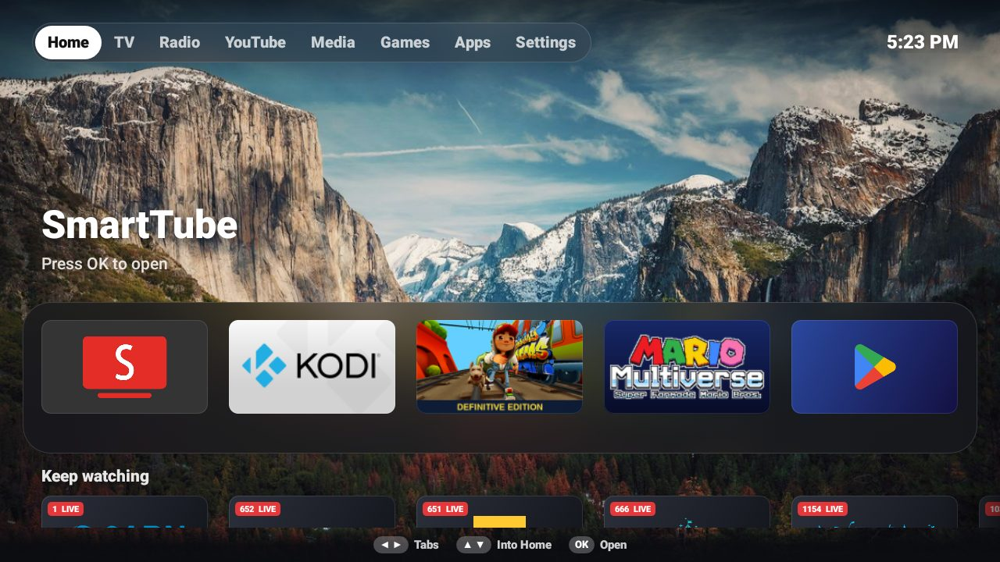
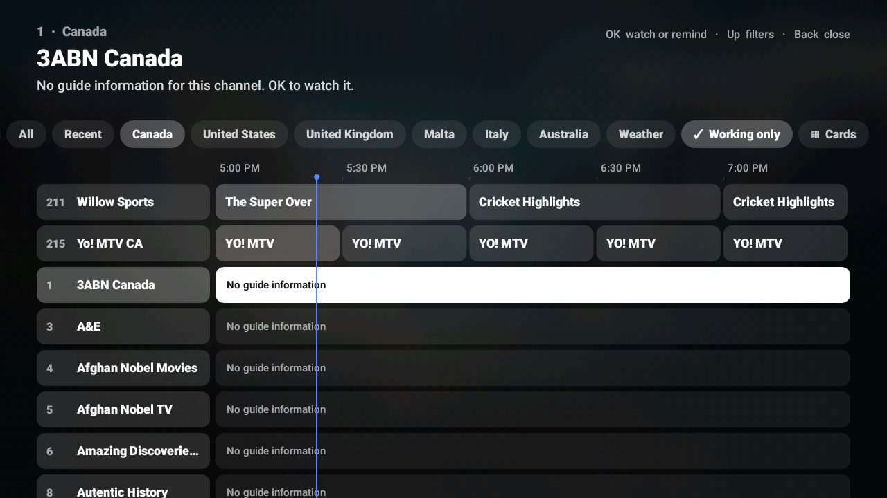
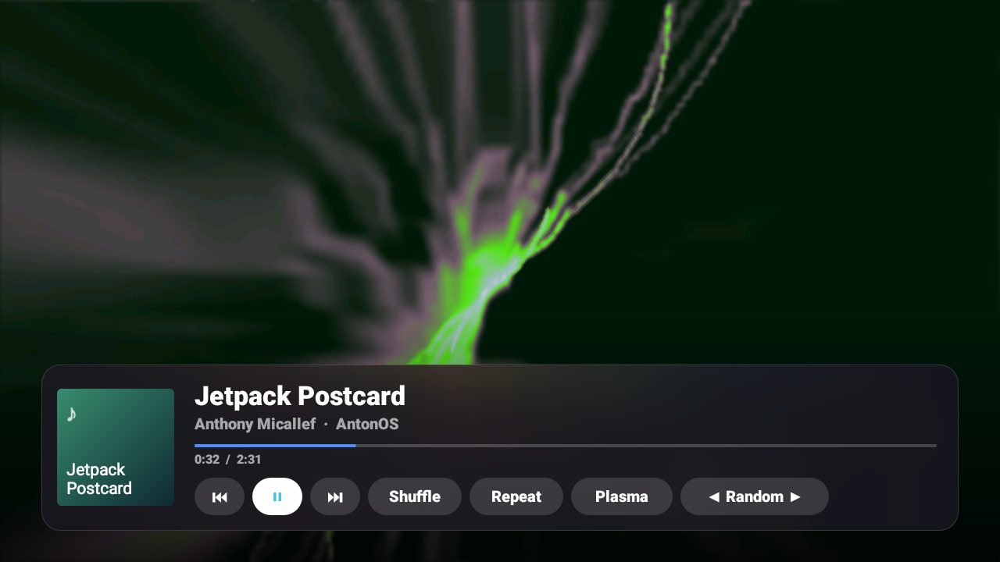
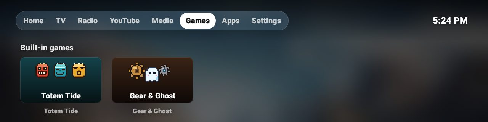

# AntonOS

*by AntonRetro.* A home screen and system for cheap Android TV boxes: TV, radio, YouTube, music, games and apps in one place, driven by a remote, a game controller, a mouse or your phone.

> **Early preview.** Built and tested on one box only: an MXQ Pro (Amlogic S905, Android 7.1, 32-bit, 1280×720). Expect rough edges on other boxes.



| TV Guide | Now Playing |
|---|---|
|  |  |



## What it does

- **Home:** your favourite apps in a dock, Keep watching / Keep playing / Recently used, and world-photo wallpapers that change through the day.
- **TV:** free channels by country with channel numbers, a TV Guide with filters (country, favourites, recent, search, "Working only"), favourites, and player controls. The channel list updates itself daily from iptv-org (numbers and favourites kept, Undo for a day), a daily check hides channels that don't play, HD and SD copies of a channel share one card (HD badge; falls back to SD), and the guide comes from free XMLTV files (i.mjh.nz, epgshare01).
- **Radio:** stations by country; keeps playing in the background.
- **YouTube:** your favourite channels as shelves and search, played in SmartTube.
- **Media:** your music with a built-in visualizer, and your videos.
- **Games:** your retro games with a 3D game page (RetroArch runs hidden as the engine), your Android games, and built-in pixel games. The controller's Guide button saves your place. Missing game engines download from libretro when a game needs one (heavy consoles marked "Not recommended" on slow boxes), new games get box art from the libretro catalogue if you say yes, and a short system intro plays before a game (can be turned off). To show a console's logo in that intro, put your own picture in `/sdcard/RetroLauncher/Logos/<console>.png` (or `<console>-white.png`, preferred, as the intro is on black). Console names: `nes`, `snes`, `gb`, `gbc`, `gba`, `n64`, `md`, `sms`, `gg`, `pce`, `ps1`. No logos are included: they belong to the console makers.
- **Phone remote:** scan a QR code on the TV and your phone (iPhone or Android, no app) becomes a remote with a keyboard, voice typing and a number pad.
- **Never stuck:** Home or the Xbox button always gets you out.

## Install (plain APK)

1. Download `AntonOS-<version>.apk` from [Releases](https://github.com/antonretro/antonos/releases) and install it on the box (from a USB stick with a file manager, or `adb install AntonOS-<version>.apk`).
2. Open AntonOS. When Android asks which home screen to use, pick **AntonOS → Always**.
3. Optional, for the Xbox button and the never-stuck menu over games: Android Settings → Accessibility → **AntonOS buttons** → On.
4. Optional extras it uses when present: **RetroArch** (games), **SmartTube** (YouTube). Put your own games in `/sdcard/RetroLauncher/Games/<system>/` and a channel list at `/sdcard/RetroLauncher/channels.m3u`.

The companion tool [android-tv-box-skill](https://github.com/antonretro/android-tv-box-skill) sets up a whole box over ADB (and offers AntonOS or Projectivy as the home screen).

## Known gaps in this preview

- Tested on one MXQ Pro only (Android 7.1, 32-bit, Mali-450). Other boxes, resolutions and Android versions are untested.
- Moving between the Home dock and the rows can stutter on slow GPUs (the full-screen wallpaper fade).
- Leaving a game with only the TV remote keeps in-game saves but not the exact place (use the controller's Guide button for that).
- The phone remote's arrows work inside AntonOS only; in other apps it does Back, Home, volume and play/pause.
- Not yet built: the TV corner mini player, themes, the first-time welcome, the built-in Files/Browser/Store apps.

## Building

Android Studio or the Gradle wrapper: `./gradlew assembleRelease`. `tools/` holds the test scripts used on a real box; put your box's address and adb path in `tools/box.env` (not committed):

```
BOX=192.168.1.50:5555
ADB=adb
```

The design, decisions and what is still to do are in [PLAN.md](PLAN.md); facts about the test box are in [BOX-FACTS.md](BOX-FACTS.md). The app ID stays `com.antonretro.launcher` and its folder `/sdcard/RetroLauncher/` (it was called Retro Launcher before 2026-11-12), so updates keep your settings.

## Licence

MIT (see [LICENSE](LICENSE)). Third-party parts and credits: [CREDITS.md](CREDITS.md). No ROMs, channel lists or box art are included; channel lists come from public sources the user chooses.
